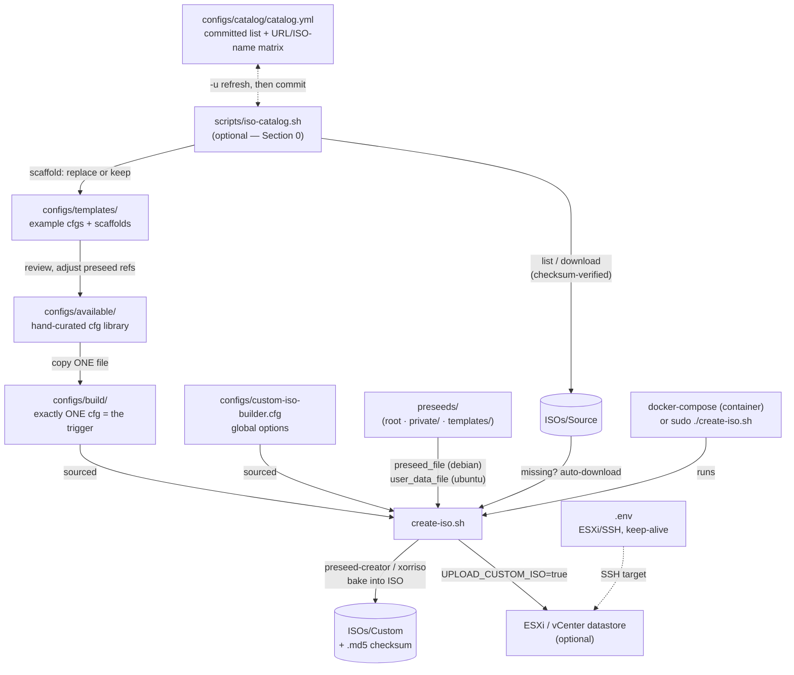

# Custom ISO Builder

**Version:** 0.4.0

Automated Debian and Ubuntu custom ISO creation with preseed/autoinstall for unattended installations.
Designed for VMware ESXi but compatible with any hypervisor or USB boot.

## Features

- ✅ **Debian preseed files** support
- ✅ **Ubuntu autoinstall files** support
- ✅ **VMware ESXi integration** with SSH upload
- ✅ **Docker support** for isolated builds
- ✅ **Cloud-init compatibility** for post-installation configuration
- ✅ **Automated dependency installation** (xorriso, isolinux, preseed-creator)
- ✅ **Configurable upload toggle** (local-only or remote)
- ✅ **ISO source caching** and override options
- ✅ **SHA256 checksum generation** (saved as `.md5` file — see TODOs)
- ✅ **ISOs Subfolders** {Source, Custom, Valid}
- ✅ **Private preseed vault** (`preseeds/private/`, git-ignored) for personal autoinstall/preseed files

## Standard Workflow

Follow these steps **in order**. Each step points to the detailed section below.


| #   | Step                                                                                                                 | Files / Directory                                                              | Details                                                                 |
| --- | -------------------------------------------------------------------------------------------------------------------- | ------------------------------------------------------------------------------ | ----------------------------------------------------------------------- |
| 1   | Discover &amp; download a new source ISO (optional — `create-iso.sh` also auto-downloads missing ISOs at build time) | `scripts/iso-catalog.sh` → `ISOs/Source/` + a scaffold in `configs/templates/` | [Section 0: Catalog Script](#0-catalog-script-iso-catalogsh)            |
| 2   | **One-time** — configure your environment                                                                            | `.env`                                                                         | [Section 1: Environment (.env)](#1-environment-env)                     |
| 3   | **One-time** — set builder options                                                                                   | `configs/custom-iso-builder.cfg`                                               | [Section 2: Builder Options](#2-builder-options-custom-iso-buildercfg)  |
| 4   | Prepare your preseed / autoinstall file                                                                              | `preseeds/` or `preseeds/private/`                                             | [Section 4: Preseed / Autoinstall Files](#4-preseed--autoinstall-files) |
| 5   | Create your OS config and point it to the preseed file                                                               | `configs/available/` (start), see templates in `configs/templates/`            | [Section 3: OS Configuration](#3-os-configuration)                      |
| 6   | **Activate the build** — copy exactly ONE config into                                                                | `configs/build/`                                                               | [Section 3: OS Configuration](#3-os-configuration)                      |
| 7   | Build the ISO                                                                                                        | `docker-compose up` (preferred) or `sudo ./create-iso.sh`                      | [Section 5: Usage](#5-usage)                                            |
| 8   | Check the result                                                                                                     | `ISOs/Custom/` (+ upload if enabled)                                           | [Section 5: Usage](#5-usage)                                            |


In short:

- **Preseed / autoinstall files** define what gets installed **inside** the target machine (users, packages, disk layout...).
- **OS config files** (`configs/`) declare *which* source ISO to download, the preseed file to bake in, and the custom ISO name.
- **`configs/build/`** is the trigger: one config file there = one build. I want to use git commits to trigger builds, so: one commit per new ISO.

### Workflow Diagram



Solid = file flow, dotted = configuration. `iso-catalog.sh` and `create-iso.sh`<br/>only meet through `ISOs/Source` and `configs/templates/` — the catalog never touches `build/`.

---

## 0. Catalog Script (`iso-catalog.sh`)

Optional helper — **the easy way to get a new source ISO** and a ready config for it.
If you skip it, `create-iso.sh` will still auto-download a missing source ISO at build time
(as long as `iso_url` is correct in your config).

```bash
scripts/iso-catalog.sh ubuntu -l                 # list what exists upstream (newest first)
scripts/iso-catalog.sh ubuntu                     # interactive: pick version + flavor → download
scripts/iso-catalog.sh ubuntu -v 26.10 -f live-server -n    # direct: download + scaffold, no prompts
scripts/iso-catalog.sh -c                         # validate all .conf URLs (available/ + build/)
scripts/iso-catalog.sh ubuntu -u                  # refresh the catalog, then commit it
```

What a download does:

- downloads to `ISOs/Source/` with a rectangle progress bar
- verifies the checksum (SHA256 Ubuntu / SHA512 Debian) before accepting the file
- skips the download if the ISO is already there (`-o` to force, e.g. corrupted ISO)
- scaffolds a config in `configs/templates/` (never `available/`, never `build/`) —
if a template already exists it is compared and you choose: replace or keep

Flavors: Ubuntu `live-server` / `desktop`; Debian `netinst` (small, needs internet at
install time) / `dvd` (~4 GB, **full offline install**). Distro specifics live in
`scripts/scaffolds/` (see `scripts/README.md`).

## 1. Environment (`.env`)

Mostly used for the Hypervisor Target. 

- Currently support only VMWare ESXI
- Proxmox is planned whenever I'll work on Proxmox again.

Copy and edit the environment template:

```bash
cp .env.example .env
```

Edit `.env` with your ESXi host and SSH credentials.

ISO Uploads target vCenter hypervisor, so the `.env` reflects that.
If you do not use vCenter, just set `configs/custom-iso-builder.cfg` → `UPLOAD_CUSTOM_ISO=false`
and find your way to upload your `.iso` image.
I may try to provide a more agnostic way to upload `.iso` on other targets, next in line would be Proxmox.


| Variable                      | Description                                             | Example                                                                                 |
| ----------------------------- | ------------------------------------------------------- | --------------------------------------------------------------------------------------- |
| `VMWARE_SSH_HOST_CONFIG`      | SSH host from `~/.ssh/config`                           | `my_esxi_host.mydomain.tld`                                                             |
| `VMWARE_DATASTORE`            | ESXi datastore name                                     | `datastore1`                                                                            |
| `VMWARE_ISO_DIRPATH` (\*)     | Directory path in datastore to store your ISOs          | `ISO/LINUX`                                                                             |
| `VMWARE_VOLUMES_PATH` (\*)    | Auto-constructed volumes path                           | `/vmfs/volumes`                                                                         |
| `VMWARE_DATASTORE_PATH` (\*)  | Auto-constructed datastore path                         | `${VMWARE_VOLUMES_PATH}/${VMWARE_DATASTORE}` → `/vmfs/volumes/datastore1`               |
| `VMWARE_ISO_UPLOAD_PATH` (\*) | Auto-constructed upload path                            | `${VMWARE_DATASTORE_PATH}/${VMWARE_ISO_DIRPATH}` → `/vmfs/volumes/datastore1/ISO/LINUX` |
| `ISO_BUILDER_KEEP_ALIVE`      | Keep the Docker container alive after build (debugging) | `false`                                                                                 |


(*): Your custom `.iso` will be uploaded to: `/vmfs/volumes/<VMWARE_DATASTORE>/<VMWARE_ISO_DIRPATH>/`

## 2. Builder Options (`custom-iso-builder.cfg`)

Edit `configs/custom-iso-builder.cfg`:


| Variable                       | Description                          | Default |
| ------------------------------ | ------------------------------------ | ------- |
| `AUTO_INSTALL_DEPS`            | Auto-install missing dependencies    | `true`  |
| `OVERRIDE_EXISTING_SOURCE_ISO` | Re-download source ISO if it exists  | `false` |
| `OVERRIDE_EXISTING_CUSTOM_ISO` | Overwrite existing custom ISO        | `true`  |
| `UPLOAD_CUSTOM_ISO`            | Upload to remote host                | `true`  |
| `VALIDATE_SSH_TARGET`          | Validate SSH before upload           | `true`  |
| `KEEP_WORKING_DIRECTORY`       | Keep working directory for debugging | `false` |
| `VERBOSE_MODE`                 | Enable debug logging                 | `true`  |


## 3. OS Configuration

The custom-iso script looks into `configs/build/` and throws an error if more than one file is present.
**This is by design as I want to use git commits to trigger the builds.**

- I may eventually add batch creation of multiple `.iso` if it proves useful.
It is not really planned as it adds loops etc. and would be more painful to debug if one of the images were to fail.
For now, I prefer a commit per new `.iso` I want to create.

### How to create a config

1. Start from `configs/templates/debian-13.1.0-example.conf` or `configs/templates/ubuntu-25.10-example.conf`, or copy an existing one from `configs/available/`.
2. Save it in `configs/available/` (your library of ready configs).
3. When you want to build, copy/move **exactly one** file into `configs/build/`.

**Debian** and **Ubuntu** URLs have some nomenclature, so normally you can simply change the version and codename,
and the script will automatically download the source `.iso` if not present (considering ISO name and URLs path logic did not change).

- Source ISOs are placed in `ISOs/Source`
- Custom ISO will be saved in `ISOs/Custom`

There is small Helper Script to download Source ISOs refer to above Section: **0. Catalog Script (iso-catalog.sh)`**

### OS config variables


| Variable             | Description                                                                 | Example                                                                 |
| -------------------- | --------------------------------------------------------------------------- | ----------------------------------------------------------------------- |
| `linux_os_type`      | Linux OS type family — drives which branch the script runs                  | `"debian"` / `"ubuntu"`                                                 |
| `debian_version`     | OS version                                                                  | `"13.1.0"` / `"25.10"`                                                  |
| `debian_codename`    | Distro codename (informational — not consumed by the script)                | `"questing"` (25.10) / `"trixie"` (13)                                  |
| `debian_arch`        | Distro architecture                                                         | `"amd64"`                                                               |
| `type`               | Ubuntu flavour used in ISO name                                             | `"live-server"` / `"desktop"`                                           |
| `debian_iso_name`    | The ISO name                                                                | `"ubuntu-25.10-live-server-amd64.iso"`                                  |
| `iso_url`            | URL to download the `.iso`                                                  | computed automatically, or input the URL                                |
| `iso_checksum`       | URL to download the `.iso` checksum                                         | computed automatically, or input the URL (not yet verified — see TODOs) |
| `iso_volume_name`    | ISO volume name (informational — not consumed by the script)                | `"ubuntu-server 25.10 amd64"`                                           |
| `config_file`        | Name of config file                                                         | Don't edit — the script finds the single file in `configs/build/`       |
| `preseed_file`       | **Debian builds**: *preseed* file to bake in (looked up in `preseeds/`)     | `"preseed_debian-13.1.0.cfg"`                                           |
| `user_data_file`     | **Ubuntu builds**: *autoinstall* file to bake in (looked up in `preseeds/`) | `"autoinstall_ubuntu-25.10-live-server.yml"`                            |
| `custom_iso_version` | Versioning of your custom `.iso`                                            | `"1.0.0"`                                                               |
| `custom_iso_comment` | Comment or "tag"                                                            | `"Test"` / `"prod"` / `"dev"` / `"lab"` / `"whatever-tag-you-see-fit"`  |
| `custom_iso_name`    | Final name of the custom `.iso`                                             | computed, or set what you want                                          |


> **Note — which preseed variable matters:**
> The script uses `preseed_file` for Debian builds and `user_data_file` for Ubuntu builds.
> The `preseed_template` / `user_data_template` variables are currently **not consumed** by the script
> (the copy-from-template logic is inert — see TODOs). Set them if you like, but the file itself must exist.

> **Note — file lookup path:** the script resolves the install file as `preseeds/[[ORCA_RICH_MD:39a3690ac38f973bc8bfcfe42e9e6458:inline-html:%3Cvalue%3E]]`.
> This means the value may include a subpath — this is how you use the private vault:
> `user_data_file="private/autoinstall_ubuntu-25.10-desktop.yml"` (see [Section 4](#4-preseed--autoinstall-files)).

### Debian Configuration Example (`debian-13.1.0.conf`)

```bash
# Linux OS Type Family (use lowercase names like 'debian' or 'ubuntu')
linux_os_type="debian"

# Debian version and ISO variables
debian_version="13.1.0"
debian_codename="trixie"
debian_arch="amd64"
debian_iso_name="debian-${debian_version}-${debian_arch}-DVD-1.iso"
iso_url="https://cdimage.debian.org/cdimage/archive/${debian_version}/${debian_arch}/iso-dvd/${debian_iso_name}"
iso_checksum="https://cdimage.debian.org/cdimage/archive/${debian_version}/${debian_arch}/iso-dvd/SHA512SUMS"

# File names (directories are hardcoded for Docker compatibility)
config_file="debian-${debian_version}.conf"
preseed_file="preseed_debian-${debian_version}.cfg"

# Custom ISO output name
custom_iso_version="1.0.1"
custom_iso_comment="custom"
custom_iso_name="debian-${debian_version}-${debian_arch}-${custom_iso_comment}-${custom_iso_version}.iso"
```

### Ubuntu Configuration Example (`ubuntu-25.10-live-server.conf`)

```bash
# Linux OS Type Family (use lowercase names like 'debian' or 'ubuntu')
linux_os_type="ubuntu"

# Ubuntu version and ISO variables
debian_version="25.10"
debian_codename="questing"
debian_arch="amd64"
type="live-server"
debian_iso_name="ubuntu-${debian_version}-${type}-${debian_arch}.iso"
iso_url="https://releases.ubuntu.com/${debian_version}/${debian_iso_name}"
iso_volume_name="ubuntu-server ${debian_version} ${debian_arch}"

# File names (directories are hardcoded for Docker compatibility)
config_file="ubuntu-${debian_version}-${type}.conf"
# Autoinstall file (Ubuntu) — replaces preseed_file.
# Add the "private/" prefix to use a personal file from preseeds/private/
user_data_file="autoinstall_ubuntu-${debian_version}-${type}.yml"
# user_data_file="private/autoinstall_ubuntu-${debian_version}-desktop.yml"
meta_data_file="meta-data"

# isolinux customization variables (informational — not consumed by the script yet)
isolinux_auto=true
isolinux_priority=critical
debian_installer_language=en_US
debian_installer_country=FR
debconf_frontend=noninteractive
console_setup_ask_detect=false

# Custom ISO output name
custom_iso_version="0.0.1"
custom_iso_comment="custom"
custom_iso_name="ubuntu-${debian_version}-${type}-${debian_arch}-${custom_iso_comment}-${custom_iso_version}.iso"
```

## 4. Preseed / Autoinstall Files

Here it is mostly on you, but the templates may help if you start from zero.
Many things are missing — for example I do not deal (yet) with LUKS or custom disk formatting;
for now it is standard disk layout only.
Basically any preseed or autoinstall file that worked for you should work with the script.

Preseed files (Debian, `.cfg`) and autoinstall files (Ubuntu, `.yml`) live in `preseeds/`, in three places:


| Location              | Purpose                                                    | Git                                                    |
| --------------------- | ---------------------------------------------------------- | ------------------------------------------------------ |
| `preseeds/` (root)    | Shareable, sanitized files                                 | **tracked**                                            |
| `preseeds/private/`   | Personal vault: real hostnames, usernames, password hashes | **ignored** (`**/private/**`, only `.gitkeep` tracked) |
| `preseeds/templates/` | Tracked starting-point templates                           | **tracked**                                            |


### Naming conventions

- **Debian**: `preseed_debian-[[ORCA_RICH_MD:39a3690ac38f973bc8bfcfe42e9e6458:inline-html:%3Cversion%3E]].cfg`
- **Ubuntu**: `autoinstall_ubuntu-[[ORCA_RICH_MD:39a3690ac38f973bc8bfcfe42e9e6458:inline-html:%3Cversion%3E]][-[[ORCA_RICH_MD:39a3690ac38f973bc8bfcfe42e9e6458:inline-html:%3Ctype%3E]]].yml` (e.g. `autoinstall_ubuntu-25.10-live-server.yml`)
- Templates use a `-template` suffix: `autoinstall_ubuntu-25.10-desktop-template.yml`, `preseed_debian-13.1.0-template.cfg`

### Using a private autoinstall file

`preseeds/private/` is never committed (see `.gitignore`). To bake one of these files into an ISO,
reference it **with the `private/` prefix** in your OS config:

```bash
user_data_file="private/autoinstall_ubuntu-25.10-desktop.yml"   # Ubuntu
preseed_file="private/preseed_debian-13.1.0-myserver.cfg"       # Debian
```

The script resolves `preseeds/[[ORCA_RICH_MD:39a3690ac38f973bc8bfcfe42e9e6458:inline-html:%3Cvalue%3E]]`, so the prefix simply routes into the vault.
The whole `preseeds/` tree (including `private/`) is mounted read-only in the Docker container,
so this works identically locally and in Docker.

> **Warning:** do not copy private files into `preseeds/` root instead — files at the root are
> tracked by git and you risk committing real credentials.

### Encrypted user passwords

To generate an encrypted password use the command:

```bash
openssl passwd -6 -salt 'MyPreciousSalt' "my_password"
# if you have special characters, use single quotes
openssl passwd -6 -salt 'B07D1A40EF8E4359A20DF2EB6D5D21A5' 'top_$ecret!'
```

### Relations between OS config files and preseed / autoinstall files

You have to point your preseed / autoinstall file inside the OS config file (see [Section 3](#3-os-configuration)).

- Preseed / autoinstall only concerns what you build inside the `.iso`
- Config files are a declarative way to name your custom ISO, provide Debian / Ubuntu ISO URLs, etc.

Naming is based on Debian and Ubuntu ISO names or URLs. You can find examples in `configs/templates/`.
Nothing blocks you from completely changing the way I labeled custom `.iso`, or how I set the download URLs.
I just find it simpler to:

- just give the actual Debian or Ubuntu version, e.g. `12.9.0`, `13.1.0`, `25.10`
- set a version number for my custom ISO
- set a "comment" e.g. `CloudInitTest`, `CloudInitReady`, `Dev`

For example:

- `debian-13.1.0-amd64-CloudInitTest-1.1.1-a.iso`
- `ubuntu-25.10-live-server-amd64-vmware_tests-0.1.1.iso`

## 5. Usage

### Discover &amp; Download New Source ISOs (catalog)

See [Section 0: Catalog Script](#0-catalog-script-iso-catalogsh) — the catalog
cache (`configs/catalog/catalog.yml`) and the URL/ISO-name nomenclature matrix
are **committed**; regenerate with `-u` when new releases land, then commit.
Before any build you can validate every cfg's URLs with `scripts/iso-catalog.sh -c`
(live checks; exits non-zero on broken links).

### Run the Script locally

The script can be run locally, but the main goal is the Docker container — it allows me to create all
my Debian / Ubuntu custom ISOs right on my MacBook Pro.

You'll need sudo to run the script.

```bash
sudo ./create-iso.sh
```

The custom ISO will be created in `ISOs/Custom/` and automatically uploaded to ESXi if you set `UPLOAD_CUSTOM_ISO=true`.

### Use Docker

The default behavior is to terminate the container after the build (either success or failure).
If you encounter issues, you may want to check things inside the container.

#### Build the Docker Image

```bash
docker-compose build --no-cache
```

#### Run the Container

```bash
docker-compose up
# or detached:
docker-compose up -d
```

#### Debugging

To keep the container running after the build:

1. Edit `.env` and set `ISO_BUILDER_KEEP_ALIVE=true`
2. `docker-compose up`
3. Access the container: `docker exec -it iso-builder /bin/bash`

#### View Logs

```bash
docker logs -f iso-builder
```

### Verify the result

- Custom ISO + checksum: `ISOs/Custom/[[ORCA_RICH_MD:39a3690ac38f973bc8bfcfe42e9e6458:inline-html:%3Ccustom_iso_name%3E]]` and `[[ORCA_RICH_MD:39a3690ac38f973bc8bfcfe42e9e6458:inline-html:%3Ccustom_iso_name%3E]].md5`
(the checksum is a SHA256 saved in a `.md5`-named file — see TODOs)
- If `UPLOAD_CUSTOM_ISO=true`: ISO lands in `/vmfs/volumes/[[ORCA_RICH_MD:39a3690ac38f973bc8bfcfe42e9e6458:inline-html:%3CVMWARE_DATASTORE%3E]]/[[ORCA_RICH_MD:39a3690ac38f973bc8bfcfe42e9e6458:inline-html:%3CVMWARE_ISO_DIRPATH%3E]]/` on the ESXi host

## Configuration Details

### Directory Structure

```
.
├── configs/
│   ├── available/                 # Your library of ready OS configs
│   ├── build/                     # ACTIVE config — exactly one file triggers the build
│   ├── templates/                 # OS config templates (Debian / Ubuntu examples)
│   └── custom-iso-builder.cfg     # Global builder options (upload toggle, overrides...)
├── preseeds/
│   ├── (root)                     # Tracked, shareable preseed (.cfg) / autoinstall (.yml) files
│   ├── private/                   # Git-ignored vault for personal files (real users, passwords, hostnames)
│   └── templates/                 # Tracked preseed / autoinstall templates
├── ISOs/
│   ├── Source/                    # Downloaded upstream ISOs (cached)
│   ├── Custom/                    # Generated custom ISOs + .md5 checksums
│   └── Valid/                     # Manually validated ISOs
├── work/                          # Notes, plans, experiments (not part of the build)
├── scripts/
│   └── docker-entrypoint.sh
├── create-iso.sh                  # Main build script
├── docker-compose.yml
└── Dockerfile-root / Dockerfile-user
```

Each directory also has its own `README.md` with a one-line summary of its files.

### SSH Configuration

The script relies on `~/.ssh/config` for SSH authentication. Ensure your SSH key is properly configured.
I found it easier to manage credentials when I use it locally.


plan to work on other ways, mainly to use this repo in CI/CD, and trigger builds when I commit a new Debian config / preseed or Ubuntu config / autoinstall.

### Network Requirements

- **Local use**: Cloudflare WARP or Tailscale recommended to access the Hypervisor.
- **SSH target**: Must be reachable when `UPLOAD_CUSTOM_ISO=true`

## Requirements

- Debian/Ubuntu Linux
- sudo access (local runs)
- SSH key authentication for ESXi upload

## Burn the .iso to USB Key

Follow this procedure: [https://documentation.ubuntu.com/desktop/en/latest/how-to/create-a-bootable-usb-stick/](https://documentation.ubuntu.com/desktop/en/latest/how-to/create-a-bootable-usb-stick/)

## TODOs

All TODOs are tracked in [TODOs.md](TODOs.md).

## Cloudflare Note

To download `preseed-creator` executable with `wget` or `curl`, add **framagit.org** to a **"Do Not Inspect"** Cloudflare Gateway HTTP policy.

## Main Contributor

oem &lt;oem@mobiloem&gt;